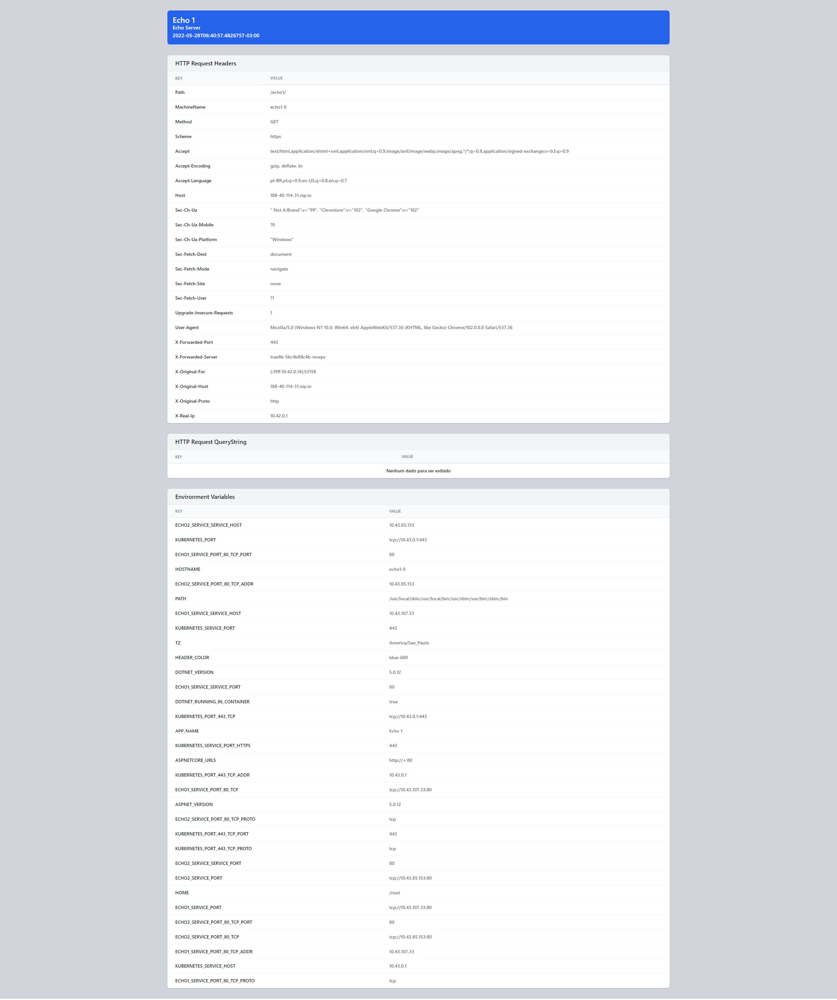

# echo-server
Echo Server - serviço de teste para Proxy Reverso e API Gateway

Antes de subir sua aplicação, valide.


| Echo 1  | Echo 2 |
| ------------- | ------------- |
|   |  |
| **EnvVars**  | **EnvVars**  |
| HEADER_COLOR=blue-600  | HEADER_COLOR=red-600  |
| APP_NAME=Echo 1  |  APP_NAME=Echo 2 |


## Formas de Uso

```sh
docker run -d -p:81:80 \
-e HEADER_COLOR=blue-600 \
-e APP_NAME="Echo 1" \
luizcarlosfaria/echo-server:latest
```
Abra o navegador em http://localhost:81

```sh
docker run -d -p:82:80 \
-e HEADER_COLOR=red-600 \
-e APP_NAME="Echo 2" \
luizcarlosfaria/echo-server:latest
```
Abra o navegador em http://localhost:82

## Variáveis de ambiente

| Variável              | Default    | Descrição |
|-----------------------|------------|-----------|
| `APP_NAME`            | `Echo`     | Nome exibido no echo e no painel. |
| `HEADER_COLOR`        | `gray-900` | Cor Tailwind do cabeçalho (veja a paleta abaixo). |
| `ECHO_MAX_REQUESTS`   | `1000`     | Quantidade de requests mantidos em memória. Ao atingir o limite, os mais antigos são expurgados. |
| `ECHO_MAX_BODY_BYTES` | `65536`    | Bytes de body armazenados por request. O excedente é truncado (`Truncated: true`), mas `Size` informa o tamanho real. |
| `ECHO_MAX_REQUEST_BYTES` | `30000000` | Bytes lidos de cada body. Acima disso o echo para de ler, mas **responde 200** e sinaliza `body_too_large` (em vez do 413 do Kestrel). |

Valores inválidos (zero, negativos ou não numéricos) impedem a subida do container com uma mensagem explícita.

## Requests em tempo real

Todo request recebido fica no histórico em memória e aparece instantaneamente no painel:

```sh
docker run -d -p 81:80 -e ECHO_MAX_REQUESTS=500 luizcarlosfaria/echo-server:latest
```

Abra http://localhost:81/_echo e envie requests para qualquer outro path.

As rotas sob `/_echo` são reservadas e **não** são ecoadas nem registradas:

| Rota | Descrição |
|------|-----------|
| `GET /_echo` | Painel com a lista ao vivo, filtro, pausa e detalhe de cada request. |
| `GET /_echo/api/requests?limit=N` | Resumos do histórico (mais recentes primeiro), com `capacity`, `count` e `totalReceived`. |
| `GET /_echo/api/requests/{id}` | Request completo (headers, query, body). Retorna 404 se já foi expurgado. |
| `DELETE /_echo/api/requests` | Limpa o histórico. |
| `/_echo/ws` | WebSocket: envia `{"type":"snapshot"}` ao conectar e depois `{"type":"request"}` a cada novo request (e `{"type":"cleared"}` ao limpar). |

Cada resposta do echo traz o header `X-Echo-Request-Id`, que é o Id do request no histórico.

> Atrás de um proxy, lembre de repassar `Upgrade`/`Connection` para o WebSocket (veja [proxy/jornada.gago.io.conf](proxy/jornada.gago.io.conf)).

## Formatos suportados

O echo aceita qualquer verbo (GET, POST, PUT, PATCH, DELETE, HEAD, OPTIONS...) em qualquer path e devolve o body em `Body`:

| `Body.Kind` | Content-Types | O que é devolvido |
|-------------|---------------|-------------------|
| `json`      | `application/json`, `text/json`, `*/*+json` (ex.: `problem+json`) | `Text`; e `Payload` com o JSON parseado (objeto, array ou primitivo). JSON inválido retorna `JsonError`, sem erro 500. |
| `xml`       | `application/xml`, `text/xml`, `*/*+xml` | `Text` |
| `text`      | `text/*`, `application/javascript`, `x-ndjson`, `yaml`, `graphql`... | `Text`, decodificado pelo `charset` informado |
| `form`      | `application/x-www-form-urlencoded` | `Form` (e o legado `Forms`) |
| `multipart` | `multipart/form-data` | `Form` mais `Files` (nome, tipo e tamanho, sem o conteúdo) |
| `binary`    | demais tipos (`application/octet-stream`, imagens...) | `Base64` |
| `none`      | sem body | n/a |

Sem `Content-Type`, o formato é detectado pelo conteúdo. Bodies chunked (sem `Content-Length`) são suportados.

Navegadores (`Accept: text/html`) recebem a página HTML; os demais clientes (curl, HttpClient, `Accept` ausente ou `*/*`) recebem JSON.

## Requests com problemas

O echo **não rejeita** requests malformados: responde `200` com tudo o que conseguiu ler e sinaliza o que encontrou de errado:

- no JSON, em `Problems: [{ "Code", "Severity", "Message" }]`;
- no header `X-Echo-Problems: json_invalid, charset_mismatch`;
- na página HTML, em um bloco destacado;
- no painel `/_echo`, com badge na lista, filtro "Só com problemas" e detalhe de cada problema.

| Code | Severity | Quando |
|------|----------|--------|
| `json_invalid` | error | Content-Type JSON, mas o body não é um JSON válido. |
| `form_invalid` | error | Form/multipart malformado (boundary ausente ou errado, limites de form excedidos). O body bruto é devolvido em `Text`/`Base64`. |
| `body_incomplete` | error | O body terminou antes do `Content-Length` declarado (ou chunked malformado). O que chegou é preservado. |
| `client_aborted` | error | O cliente derrubou a conexão no meio do envio. O request fica no histórico, mesmo sem resposta possível. |
| `content_length_mismatch` | error | `Content-Length` diferente da quantidade de bytes recebida. |
| `body_too_large` | warning | O body passou de `ECHO_MAX_REQUEST_BYTES`. A leitura foi interrompida. |
| `content_type_invalid` | warning | `Content-Type` ilegível. O formato do body é deduzido pelo conteúdo. |
| `charset_unknown` | warning | Charset desconhecido. O body é decodificado como UTF-8. |
| `charset_mismatch` | warning | Bytes inválidos para o charset declarado (ex.: Latin-1 enviado como UTF-8). |
| `body_truncated` | info | O body foi armazenado parcialmente (`ECHO_MAX_BODY_BYTES`). |

Não há como sinalizar falhas que o servidor HTTP rejeita antes de a aplicação ver o request: request line ou headers malformados (400), headers grandes demais (431), ou uma conexão que envia o request e fecha antes de o Kestrel começar a processá-la.

## Desenvolvimento

Requer o SDK do .NET 11.

```sh
dotnet test --project tests/EchoServer.IntegrationTests   # testes de integração (WebApplicationFactory)
dotnet run --project echo-server                          # http://localhost:5080/_echo
```

## Paleta de Cores

[](https://tailwindcss.com/docs/customizing-colors)

## Usando EchoServer por linha de comando

Abaixo tenho um exemplo real de troubleshooting de ingress controller do Kubernetes.

```sh
curl -v  http://localhost/echo2?a=1 -H 'Content-Type: application/json' -H 'Accept: application/json' -d '{}'


*   Trying 127.0.0.1:80...
* TCP_NODELAY set
* Connected to localhost (127.0.0.1) port 80 (#0)
> POST /echo1?a=1 HTTP/1.1
> Host: localhost
> User-Agent: curl/7.68.0
> Content-Type: application/json
> Accept: application/json
> Content-Length: 2
>
* upload completely sent off: 2 out of 2 bytes
* Mark bundle as not supporting multiuse
< HTTP/1.1 200 OK
< Content-Length: 2374
< Content-Type: application/json
< Date: Sat, 28 May 2022 08:31:20 GMT
< Server: Kestrel
<
{
  "AppName": "Echo 1",
  "Now": "2022-05-28T05:31:21.3113989-03:00",
  "UtcNow": "2022-05-28T08:31:21.3114091Z",
  "Headers": {
    "Content-Type": [
      "application/json"
    ],
    "Accept": [
      "application/json"
    ],
    "Accept-Encoding": [
      "gzip"
    ],
    "Host": [
      "localhost"
    ],
    "User-Agent": [
      "curl/7.68.0"
    ],
    "Content-Length": [
      "2"
    ],
    "X-Original-Proto": [
      "http"
    ],
    "X-Forwarded-Port": [
      "80"
    ],
    "X-Original-Host": [
      "localhost"
    ],
    "X-Forwarded-Server": [
      "traefik-56c4b88c4b-nvsqw"
    ],
    "X-Real-Ip": [
      "10.42.0.1"
    ],
    "X-Original-For": [
      "[::ffff:10.42.0.14]:49378"
    ]
  },
  "Path": "/echo1",
  "MachineName": "echo1-0",
  "Method": "POST",
  "Scheme": "http",
  "QueryString": [
    {
      "Key": "a",
      "Value": [
        "1"
      ]
    }
  ],
  "Forms": [],
  "Payload": {},
  "EnvironmentVariables": {
    "ECHO2_SERVICE_SERVICE_HOST": "10.43.85.153",
    "KUBERNETES_PORT": "tcp://10.43.0.1:443",
    "ECHO1_SERVICE_PORT_80_TCP_PORT": "80",
    "HOSTNAME": "echo1-0",
    "ECHO2_SERVICE_PORT_80_TCP_ADDR": "10.43.85.153",
    "PATH": "/usr/local/sbin:/usr/local/bin:/usr/sbin:/usr/bin:/sbin:/bin",
    "ECHO1_SERVICE_SERVICE_HOST": "10.43.107.33",
    "KUBERNETES_SERVICE_PORT": "443",
    "TZ": "America/Sao_Paulo",
    "HEADER_COLOR": "blue-600",
    "DOTNET_VERSION": "5.0.12",
    "ECHO1_SERVICE_SERVICE_PORT": "80",
    "DOTNET_RUNNING_IN_CONTAINER": "true",
    "KUBERNETES_PORT_443_TCP": "tcp://10.43.0.1:443",
    "APP_NAME": "Echo 1",
    "KUBERNETES_SERVICE_PORT_HTTPS": "443",
    "ASPNETCORE_URLS": "http://+:80",
    "KUBERNETES_PORT_443_TCP_ADDR": "10.43.0.1",
    "ECHO1_SERVICE_PORT_80_TCP": "tcp://10.43.107.33:80",
    "ASPNET_VERSION": "5.0.12",
    "ECHO2_SERVICE_PORT_80_TCP_PROTO": "tcp",
    "KUBERNETES_PORT_443_TCP_PORT": "443",
    "KUBERNETES_PORT_443_TCP_PROTO": "tcp",
    "ECHO2_SERVICE_SERVICE_PORT": "80",
    "ECHO2_SERVICE_PORT": "tcp://10.43.85.153:80",
    "HOME": "/root",
    "ECHO1_SERVICE_PORT": "tcp://10.43.107.33:80",
    "ECHO2_SERVICE_PORT_80_TCP_PORT": "80",
    "ECHO2_SERVICE_PORT_80_TCP": "tcp://10.43.85.153:80",
    "ECHO1_SERVICE_PORT_80_TCP_ADDR": "10.43.107.33",
    "KUBERNETES_SERVICE_HOST": "10.43.0.1",
    "ECHO1_SERVICE_PORT_80_TCP_PROTO": "tcp"
  }
* Connection #0 to host localhost left intact

```

## Tempo de Resposta base

| Deploy 						| Acesso / Formato 		| Tempo 		| Acesso / Formato		| Tempo |
|-------------------------------|-----------------------|---------------|-----------------------|-------|
| docker run 					| Browser / HTML 		| 3ms 			| curl / JSON			| 2ms   |
| Visual Studio Run 			| Browser / HTML 		| 12ms 			| curl / JSON  			| 4ms   |
| Visual Studio Detached Run 	| Browser / HTML 		| 4ms 			| curl / JSON  			| 3ms   |

