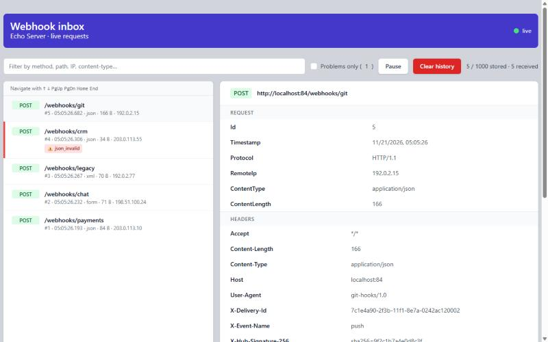

# echo-server

Echo Server: a test service for **reverse proxies, ingress controllers, API gateways and webhooks**.

It answers **any method on any path** by returning exactly what it received: method, path, headers, query string, body, client IP and the container's environment variables. It also keeps the latest requests in memory and shows them **live** in a web dashboard.

Use it to:

- **Validate a route** before putting your application behind a proxy, ingress or gateway: see the `Host`, scheme, client IP and headers that actually arrive.
- **Inspect webhooks**: point any provider at it and watch each delivery (headers, signature, payload) as it arrives. It's a **self-hosted alternative to [webhook.site](https://webhook.site)**; see [Testing webhooks](#testing-webhooks).



| Echo 1  | Echo 2 |
| ------------- | ------------- |
|   |  |
| `HEADER_COLOR=blue-600`  | `HEADER_COLOR=red-600`  |
| `APP_NAME=Echo 1`  |  `APP_NAME=Echo 2` |

## Contents

- [Features](#features)
- [Quick start](#quick-start)
- [Testing webhooks](#testing-webhooks)
- [Environment variables](#environment-variables)
- [Using the echo](#using-the-echo)
- [Supported body formats](#supported-body-formats)
- [Requests with problems](#requests-with-problems)
- [Live dashboard](#live-dashboard)
- [History API and WebSocket](#history-api-and-websocket)
- [Behind a reverse proxy](#behind-a-reverse-proxy)
- [Development](#development)
- [Upgrading from 2.x](#upgrading-from-2x)
- [Known limitations](#known-limitations)
- [Color palette](#color-palette)

## Features

- **Full echo** of any method (GET, POST, PUT, PATCH, DELETE, HEAD, OPTIONS…) on any path.
- **HTML for browsers, JSON for everything else**, chosen by the `Accept` header.
- **Common body formats**: JSON, XML, text with charset, form-urlencoded, multipart (with files) and binary.
- **Fault tolerant**: malformed requests are accepted and their problems are reported, instead of turning into a 500 or 413 error.
- **Webhook inspector**: every delivery gets a `200` right away and shows up in the dashboard with its headers, signature and payload. Self-hosted, no account, no third party holding your payloads.
- **In-memory history** of the last N requests (default 1000); the oldest ones are discarded.
- **Live dashboard** (`/_echo`, configurable) over WebSocket: requests appear instantly, with full details, filter, "problems only", pause and keyboard navigation.
- **Proxy ready**: `X-Forwarded-For`, `X-Forwarded-Proto`, `X-Forwarded-Host` and `X-Forwarded-Prefix` are applied, and the original values stay visible.
- **Written in Go**: a single static binary in a ~22 MB distroless image, listening on **port 80**.

## Quick start

```sh
docker run -d -p 81:80 \
  -e HEADER_COLOR=blue-600 \
  -e APP_NAME="Echo 1" \
  luizcarlosfaria/echo-server:latest
```

- Echo in the browser: http://localhost:81
- Live dashboard: http://localhost:81/_echo

To see two instances side by side, for example behind a load balancer:

```sh
docker run -d -p 82:80 \
  -e HEADER_COLOR=red-600 \
  -e APP_NAME="Echo 2" \
  luizcarlosfaria/echo-server:latest
```

## Testing webhooks

The echo is a **self-hosted alternative to [webhook.site](https://webhook.site)** and similar request inspectors: point a provider (payments, Git hosting, chat, CRM, your own services…) at it and see every delivery in the [live dashboard](#live-dashboard) as soon as it arrives.

1. Start an instance for the webhooks. Hide the environment, since the deliveries may be visible to others:

   ```sh
   docker run -d -p 8080:80 \
     -e APP_NAME="Webhook inbox" \
     -e ECHO_SHOW_ENVIRONMENT=false \
     luizcarlosfaria/echo-server:latest
   ```

2. Make it reachable by the provider. Inside your network (Kubernetes, Docker, staging), use its internal address. From the internet, publish it with a tunnel such as `cloudflared tunnel --url http://localhost:8080` or `ngrok http 8080`, or deploy it behind your ingress.

3. Register the webhook URL. **Any path works**, so give each provider its own path to tell them apart: `https://<host>/webhooks/payments`, `https://<host>/webhooks/git`…

4. Open `https://<host>/_echo` and trigger an event. Each delivery shows up instantly with:
   - **all the headers**, including signatures and delivery ids (`X-Hub-Signature-256`, `Stripe-Signature`, `X-Request-Id`…);
   - the **payload**: formatted JSON, XML, text, form fields or base64, plus the raw text, handy to check a signature;
   - **problems** with the delivery, such as invalid JSON or a wrong charset, highlighted in red;
   - the client IP and the `X-Forwarded-*` headers added by tunnels and proxies.

   Filter by path to follow a single provider, and use **Pause** to freeze the list while you read.

Every delivery gets an immediate `200` (with the echo JSON as the body), so providers mark it as delivered and don't retry. You can also fetch deliveries from a script through the [history API](#history-api-and-websocket).

**Compared with a hosted inspector**: your payloads never leave your infrastructure, there's no account and no expiring URL, it works in private networks and CI, and you control how many requests are kept (`ECHO_MAX_REQUESTS`). On the other hand, you have to expose it yourself, the history lives only in memory, and the response is always `200` with the echo JSON: you can't script custom responses (status code, body or delays), so handshakes that expect a specific reply, such as a challenge echo, won't complete.

> The dashboard and the history API have **no authentication**. When the echo is reachable from the internet, anyone who knows the URL can read the deliveries. Keep `ECHO_SHOW_ENVIRONMENT=false`, keep the instance short-lived, and consider moving the dashboard to a less obvious path with `ECHO_DASHBOARD_PATH`, which is obscurity rather than protection.

## Environment variables

All of them are optional.

| Variable | Default | Description |
|----------|---------|-------------|
| `APP_NAME` | `Echo` | Name shown in the echo and the dashboard. Useful to tell instances apart. |
| `HEADER_COLOR` | `gray-900` | [Tailwind](#color-palette) color of the header (e.g. `blue-600`, `red-600`). |
| `ECHO_SHOW_ENVIRONMENT` | `true` | Includes the container's environment variables in the echo (JSON and HTML). Use `false` when they may contain secrets. |
| `ECHO_MAX_REQUESTS` | `1000` | Number of requests kept in the in-memory history. When the limit is reached, the oldest ones are discarded. |
| `ECHO_MAX_BODY_BYTES` | `65536` | Body bytes **stored** per request. The rest is truncated (`Truncated: true`), but `Size` still reports the real size. |
| `ECHO_MAX_REQUEST_BYTES` | `30000000` | Body bytes **read** per request. Beyond that the echo stops reading, but **still answers 200** and reports `body_too_large` (instead of a 413). |
| `ECHO_PORT` | `80` | HTTP port the server listens on. |
| `ECHO_DASHBOARD_PATH` | `/_echo` | Path of the dashboard, its API and its WebSocket. Change it when `/_echo` collides with a route you want to echo (e.g. `/ops/echo`). Letters, digits, `-`, `.`, `_`, `~` and `/` only; the leading `/` is optional and a trailing `/` is ignored. |
| `TZ` | `America/Sao_Paulo` | Time zone of the `Now` field and of the HTML page (`UtcNow` is always UTC). Any IANA name, e.g. `UTC` or `Europe/Lisbon`. |

**Booleans** accept `true`/`false`, `1`/`0`, `yes`/`no`, `y`/`n`, `on`/`off` and `sim`/`não`, case-insensitive.

**Invalid values prevent the container from starting**, with a message naming the wrong variable: zero or negative numbers, text where a number is expected, an unknown boolean, an `ECHO_PORT` outside 1–65535, or an `ECHO_DASHBOARD_PATH` that is `/` or has empty, `.` or `..` segments or other characters. The echo never silently falls back to the default.

Example of a "quiet" container that hides the environment and keeps a smaller history:

```sh
docker run -d -p 81:80 \
  -e ECHO_SHOW_ENVIRONMENT=false \
  -e ECHO_MAX_REQUESTS=200 \
  luizcarlosfaria/echo-server:latest
```

## Using the echo

### HTML or JSON

| Client | `Accept` | Response |
|--------|----------|----------|
| Browser | `text/html,…` | HTML page |
| curl | `*/*` | JSON |
| HttpClient, fetch, SDKs… | missing, `application/json`, etc. | JSON |

Clients asking for `text/html` (or `application/xhtml+xml`) get HTML. Everyone else gets JSON.

### Example

```sh
curl -X POST 'http://localhost:81/orders?source=readme' \
  -H 'Content-Type: application/json' \
  -H 'X-Correlation-Id: abc-123' \
  -d '{"customer":"Ana","items":[1,2]}'
```

```jsonc
{
  "RequestId": 61,
  "AppName": "Echo 1",
  "Now": "2026-11-21T00:38:27.6831246-03:00",
  "UtcNow": "2026-11-21T03:38:27.6831307Z",
  "Headers": {
    "Accept": [ "*/*" ],
    "Content-Length": [ "32" ],
    "Content-Type": [ "application/json" ],
    "Host": [ "localhost:81" ],
    "User-Agent": [ "curl/8.22.0" ],
    "X-Correlation-Id": [ "abc-123" ]
  },
  "Path": "/orders",
  "PathBase": "",
  "MachineName": "a1b2c3d4e5f6",
  "Method": "POST",
  "Scheme": "http",
  "Host": "localhost:81",
  "Protocol": "HTTP/1.1",
  "RemoteIp": "172.17.0.1",
  "Problems": [],
  "QueryString": [ { "Key": "source", "Value": [ "readme" ] } ],
  "Forms": [],
  "Payload": { "customer": "Ana", "items": [ 1, 2 ] },
  "Body": {
    "Kind": "json",
    "Size": 32,
    "Truncated": false,
    "Charset": "utf-8",
    "Text": "{\"customer\":\"Ana\",\"items\":[1,2]}"
  },
  "EnvironmentVariables": { "APP_NAME": "Echo 1", "...": "..." }
}
```

### Response fields

| Field | Description |
|-------|-------------|
| `RequestId` | Id of the request in the history (also in the `X-Echo-Request-Id` header). |
| `AppName`, `MachineName` | Identify the instance. Useful to check load balancing. |
| `Now`, `UtcNow` | Server time (local, according to `TZ`, and UTC). |
| `Method`, `Scheme`, `Host`, `Path`, `PathBase`, `Protocol` | How the request arrived, **with `X-Forwarded-*` already applied**. |
| `RemoteIp` | Client IP (from `X-Forwarded-For`, when present). |
| `Headers` | All headers, in alphabetical order. The originals replaced by `X-Forwarded-*` show up as `X-Original-*`. |
| `QueryString` | Query parameters, including repeated keys, in alphabetical order. |
| `Forms` | Form fields, in the legacy `[{ Key, Value }]` format. |
| `Payload` | The body's JSON, already parsed (object, array or primitive). Present only when the body is valid JSON. |
| `Body` | Body details; see [formats](#supported-body-formats). |
| `Problems` | Problems detected in the request; see [requests with problems](#requests-with-problems). |
| `EnvironmentVariables` | The container's environment variables. Omitted when `ECHO_SHOW_ENVIRONMENT=false`. |

`HEAD` requests get the same headers, without a body.

## Supported body formats

| `Body.Kind` | Content-Types | What is returned |
|-------------|---------------|------------------|
| `json` | `application/json`, `text/json`, `*/*+json` (e.g. `problem+json`, `vnd.api+json`) | `Text`, plus `Payload` with the parsed JSON |
| `xml` | `application/xml`, `text/xml`, `*/*+xml` (e.g. `soap+xml`) | `Text` |
| `text` | `text/*`, `application/javascript`, `x-ndjson`, `yaml`, `graphql`, `csv`… | `Text`, decoded with the declared `charset` (UTF-8, Latin-1…) |
| `form` | `application/x-www-form-urlencoded` | `Form` (and the legacy `Forms`) |
| `multipart` | `multipart/form-data` | `Form` plus `Files` (name, type and size of each file, not its content) |
| `binary` | anything else (`application/octet-stream`, images, PDF…) | `Base64` |
| `none` | no body | n/a |

Also:

- **Without a `Content-Type`**, the format is inferred from the content: valid JSON becomes `json`, UTF-8 text becomes `text`, and the rest becomes `binary`.
- **Chunked bodies** (no `Content-Length`) are read in full.
- **Any method** may carry a body, including `GET` and `DELETE`.
- `Body.Size` is always the real size received, even when the stored content was truncated.

## Requests with problems

The echo **does not reject** malformed requests. It answers `200` with everything it managed to read and reports what was wrong:

- in the JSON: `Problems: [{ "Code", "Severity", "Message" }]`;
- in the `X-Echo-Problems: json_invalid, charset_mismatch` header (visible with `curl -I`, without reading the body);
- on the HTML page, in a highlighted block at the top;
- in the `/_echo` dashboard, with a badge and a colored border in the list, a "Problems only" filter and the details of each problem.

| Code | Severity | When it happens |
|------|----------|-----------------|
| `json_invalid` | error | The Content-Type says JSON, but the body is not valid JSON. |
| `form_invalid` | error | Malformed form or multipart (missing or wrong boundary, broken part). The raw body is returned in `Text`/`Base64`. |
| `body_incomplete` | error | The body ended before the declared `Content-Length`, the chunked encoding is malformed, or no data arrived for 30 seconds. What arrived is kept. |
| `client_aborted` | error | The client dropped the connection mid-upload. |
| `content_length_mismatch` | error | The `Content-Length` differs from the number of bytes received. In practice the HTTP server enforces `Content-Length`, so a shorter body is reported as `body_incomplete`; this code remains for compatibility. |
| `body_too_large` | warning | The body went past `ECHO_MAX_REQUEST_BYTES`, and reading stopped. |
| `content_type_invalid` | warning | Unreadable `Content-Type`. The body format is inferred from its content. |
| `charset_unknown` | warning | Unknown charset. The body is decoded as UTF-8. |
| `charset_mismatch` | warning | Bytes that are invalid for the declared charset (e.g. Latin-1 sent as UTF-8). |
| `body_truncated` | info | The body was only partially stored (`ECHO_MAX_BODY_BYTES`). |

With `body_incomplete` and `client_aborted` the connection is broken, so the echo closes it **without a response**; the request still enters the history with what arrived.

```sh
curl -si -X POST http://localhost:81/test -H 'Content-Type: application/json' -d '{"customer": ' | grep X-Echo
# X-Echo-Request-Id: 7
# X-Echo-Problems: json_invalid
```

## Live dashboard

Open **`/_echo`** (e.g. http://localhost:81/_echo, or the path set in `ECHO_DASHBOARD_PATH`). Every request shows up instantly, without reloading the page, so you can keep it open on one side while you drive traffic through a proxy or trigger webhooks on the other.

- **Live list** with method, path, time, body type and size, IP and problems; requests with problems get a colored border.
- **Details** of the selected request: problems, request data, headers, query and body (formatted JSON, text, form fields, files or base64).
- **Filter** by method, path, IP, content-type, Id or problem code.
- **Problems only**: shows just the requests that have problems.
- **Pause/Resume**: freezes the list. Requests that arrive while paused show up when you resume.
- **Clear history**: deletes the history on the server and in every open dashboard.
- **Automatic reconnection**, with a status indicator (live, paused or disconnected).
- **Several viewers at once**: every open dashboard receives the same events, and a slow one never delays the echo.

### Keyboard shortcuts

| Key | Action |
|-----|--------|
| <kbd>Home</kbd> | Selects the first request (the most recent one). |
| <kbd>End</kbd> | Selects the last request (the oldest one in the list). |
| <kbd>PgUp</kbd> / <kbd>PgDn</kbd> | Moves one page up or down the list. |
| <kbd>↑</kbd> / <kbd>↓</kbd> | Moves one request up or down. |

Navigation honors the active filter and keeps the selected item in view. While the cursor is in the filter box, these keys keep editing the text as usual.

## History API and WebSocket

Routes under `/_echo` are **reserved**: they are not echoed and do not enter the history. The prefix comes from `ECHO_DASHBOARD_PATH`; with `ECHO_DASHBOARD_PATH=/ops/echo`, every route below moves to `/ops/echo/...` and `/_echo` is echoed like any other path. Matching is case-insensitive and by segment (`/_echox` is not reserved).

| Route | Description |
|-------|-------------|
| `GET /_echo` | Live dashboard. |
| `GET /_echo/api/requests?limit=N` | History summaries, newest first, with `capacity`, `count` and `totalReceived`. |
| `GET /_echo/api/requests/{id}` | Full request (headers, query, body and problems). Returns `404` if it has already been discarded. |
| `DELETE /_echo/api/requests` | Clears the history. |
| `GET /_echo/ws` | WebSocket with live events. |

### WebSocket protocol

JSON messages (camelCase), from server to client:

```jsonc
// On connect: the current state
{ "type": "snapshot", "capacity": 1000, "totalReceived": 42, "items": [ /* summaries */ ] }

// For every request received
{ "type": "request", "totalReceived": 43, "item": {
    "id": 43, "timestamp": "2026-11-21T03:38:27.6831307+00:00", "method": "POST", "scheme": "http",
    "host": "localhost:81", "path": "/orders", "queryString": "?source=readme",
    "remoteIp": "172.17.0.1", "contentType": "application/json",
    "bodyKind": "json", "bodySize": 32, "bodyTruncated": false,
    "problems": [] } }   // with problems: "problems": ["json_invalid"], "problemSeverity": "error"

// When the history is cleared
{ "type": "cleared", "totalReceived": 43 }
```

The WebSocket only sends **summaries**. The full content is fetched on demand from `/_echo/api/requests/{id}`. Each connection has its own queue, so a slow client loses older events but never delays the echo or the other clients.

```sh
# follow it from the terminal (requires websocat)
websocat ws://localhost:81/_echo/ws
```

## Behind a reverse proxy

The echo trusts `X-Forwarded-*` headers from **any source**, since its purpose is to show what the proxy sent. Do not expose it directly to the internet expecting those headers to be trustworthy.

For the dashboard to work behind a proxy, the proxy must forward the WebSocket upgrade. With nginx:

```nginx
map $http_upgrade $connection_upgrade {
    default upgrade;
    ''      close;
}

server {
    listen 80;
    location / {
        proxy_pass         http://echo:80;
        proxy_http_version 1.1;
        proxy_set_header   Upgrade $http_upgrade;
        proxy_set_header   Connection $connection_upgrade;
        proxy_set_header   Host $host;
        proxy_set_header   X-Forwarded-For $proxy_add_x_forwarded_for;
        proxy_set_header   X-Forwarded-Proto $scheme;
        proxy_read_timeout 1h;   # the dashboard keeps the WebSocket open
    }
}
```

The repository includes a full nginx example in [`docker-compose.yml`](docker-compose.yml) and [`proxy/`](proxy/):

```sh
docker compose up --build
# http://localhost/        echo through nginx
# http://localhost/_echo   dashboard through nginx
```

### Example: troubleshooting a Kubernetes ingress

```sh
curl -s http://my-ingress/echo1?a=1 -H 'Accept: application/json'
```

The response shows the `Host`, `Scheme` and `RemoteIp` the pod actually received, the headers the ingress added or removed (`X-Forwarded-*`, `X-Real-Ip`, `X-Original-*`) and, through `MachineName`, which replica served the request.

## Development

Requires **Go 1.27+** (see [`go.mod`](go.mod)). The only dependencies are `github.com/coder/websocket` and `golang.org/x/text`.

```sh
ECHO_PORT=8080 go run ./cmd/echo-server   # http://localhost:8080/_echo
go test -race ./...                       # unit and integration tests
docker build -t echo-server .             # image
```

Without Go installed, run the same commands in a container:

```sh
docker run --rm -v "$PWD:/src" -w /src golang:1.27 go test -race ./...
```

### Layout

```text
cmd/echo-server/           entry point: HTTP server, timeouts, graceful shutdown
internal/
├── config/                environment variables (fail fast on invalid values)
├── forwarded/             X-Forwarded-* → Scheme/Host/RemoteIp/PathBase, X-Original-*
├── capture/               request reading: limits, body formats, charsets, problems
├── model/                 captured request, body, problems and summaries
├── store/                 in-memory history (ring buffer) and subscriptions
├── echo/                  catch-all echo: JSON (PascalCase) and HTML
├── dashboard/             dashboard page, API and WebSocket under ECHO_DASHBOARD_PATH (/_echo)
├── web/                   HTML templates (html/template + Tailwind) and dashboard.js, embedded
└── app/                   wiring, plus the integration tests
scripts/parity/            compares two running instances request by request
proxy/                     example nginx
```

### Tests

The integration tests in `internal/app` start the real application with `httptest` and cover methods, paths, body formats, HTML vs JSON, `X-Forwarded-*`, history and eviction, environment variables, concurrency, WebSocket and requests with problems. Scenarios that only exist on a real connection (a body shorter than its `Content-Length`, a dropped connection, a body over the limit) send raw bytes over a TCP socket.

`scripts/parity` sends the same requests to two running instances (for example, an older image and a new build) and reports every difference in status, `X-Echo-*` headers, echo JSON and history API, ignoring the fields that change by nature (time, hostname, IPs, environment):

```sh
go run ./scripts/parity -a http://old-echo -b http://new-echo   # add -dashboard /ops/echo if ECHO_DASHBOARD_PATH was changed
```

## Upgrading from 2.x

Version 3 keeps the same routes, JSON, headers, problem codes and dashboard, so clients don't need changes. What changed for whoever runs the image:

- **Port**: the port and logging variables of 2.x are ignored. To change the port, use `ECHO_PORT`.
- **No shell in the image**: it's a distroless image with a single binary, so `docker exec <container> sh` no longer works. Use the dashboard, the history API or a debug container.
- **Ordering**: `Headers` and `QueryString` come in alphabetical order.
- **`X-Original-For`** shows an IPv4 client as `172.22.0.4:port` instead of `[::ffff:172.22.0.4]:port`.
- **New variables**: `ECHO_PORT` and `ECHO_DASHBOARD_PATH`.

## Known limitations

- **History is in memory only**: restarting the container clears it, and each replica has its own history.
- **No authentication**: the dashboard, the API and the echo are open. With `ECHO_SHOW_ENVIRONMENT=true` (the default), the container's environment variables are visible to anyone.
- **Failures rejected by the HTTP server** before the application sees the request cannot be reported: malformed request line or headers (400), headers too large (431), or a connection that sends the request and closes before processing starts.
- **Multipart files**: only metadata (name, type and size) is stored, never the content.
- **Fixed response**: the echo always answers `200` with the echo JSON (or HTML). Custom status codes, bodies or delays can't be configured.

## Color palette

Values accepted by `HEADER_COLOR`:

[](https://tailwindcss.com/docs/customizing-colors)
